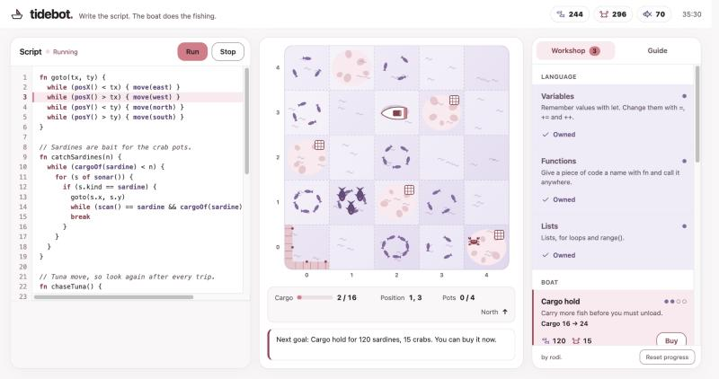

# Tidebot

A programming game: write a script, and a small fishing boat follows it.

[Play it in the browser](https://byrodi.github.io/tidebot/)



## How it plays

1. Press Run. The starter script fishes one cell and returns to the dock.
2. Wrap it in `while (true)` and the boat repeats the trip.
3. Sell the catch at the dock and buy upgrades in the Workshop.
4. Finish the tasks to unlock variables, functions and lists.
5. Build the lighthouse to win.

## Highlights

- A small JavaScript-like language with its own interpreter
- The running line is highlighted while the boat works
- Sardines, crab pots and moving tuna shoals
- A bigger sea, from 3×3 up to 8×8
- Progress is saved in your browser

## Run locally

No build step. Serve the folder with any static server:

```bash
npm run serve
```

Then open http://localhost:8123.

## Tests

```bash
npm test
```

## License

[MIT](LICENSE)
